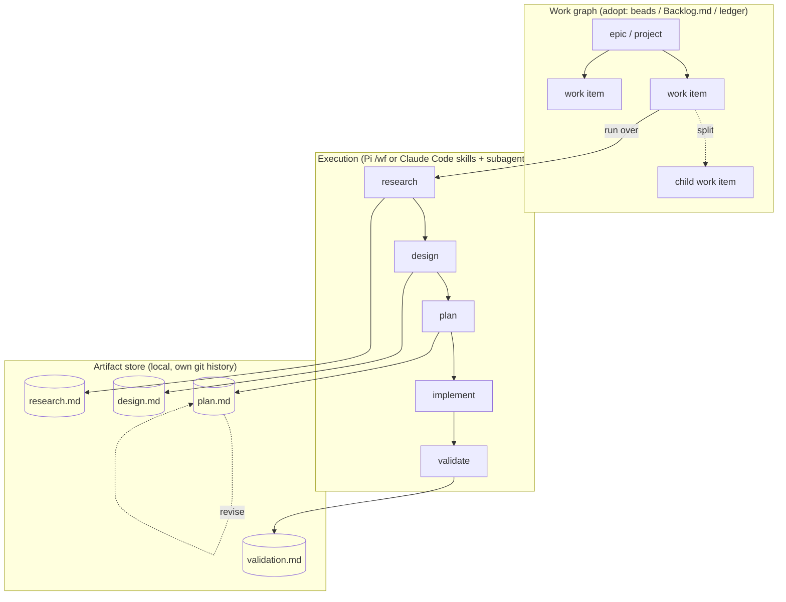

# What the RPIV workflow needs

This builds on [01 inspirations](01-inspirations.md) and [02 landscape](02-landscape.md).
Every "leaning" below is a proposal for the user to confirm, not a decision. Confirmed
decisions go in `PROGRESS.md`.

## Summary

> [!IMPORTANT] Proposed shape
> Build the workflow as **three loosely coupled layers joined by stable IDs**:
> 1. **Artifact store** (documents): markdown with a small shared front-matter envelope,
>    kept *outside* the product repo's history in a local store with its own git history.
> 2. **Work graph** (orchestration over time): work items, dependencies, status, and
>    splits. **Adopt** here (beads or Backlog.md) rather than build, and decide by mock runs.
> 3. **Execution** (runs): phase skills plus a runner. Reuse rpiv's methods; make the
>    core host-agnostic so it can run under Pi (rpiv-workflow) or Claude Code (subagents).



What the three layers buy us:

- **Reviewability (req. 1)** comes from the artifact store: plain markdown, diffable, rendered by `html-report`.
- **Revision (req. 2)** comes from the store's own git history plus an explicit revision log in each artifact.
- **Splitting (req. 3)** is a work-graph operation whose children point back at the parent's artifacts.
- **Orchestration (req. 4)** is the work graph's job, so we don't build a tracker.
- **Locality (req. 5)** comes from the store living outside the product repo.
- **Delegation (req. 6)** is the execution layer's job, fed by plans detailed enough for a cheaper model.

## Part 1: Per-phase needs

Each phase lists what it must do, the existing options, and the current leaning.

### 0. Intake (capture intent)

**Needs:** capture the brief verbatim as the north star. Record goals, non-goals,
constraints, and acceptance intent. Attach the brief to a work item.

| Option | Pros | Cons |
| --- | --- | --- |
| rpiv `discover` + `goal` artifact | One question at a time, then a decisions block. The verbatim goal anchors validation. | Pi-only |
| OpenSpec `proposal.md` | Short, with explicit capabilities | No interview |
| BMAD Analyst → PRD | Thorough | Heavy for small work |
| Superpowers `brainstorm` | Auto-triggers and blocks premature coding | Output is less structured |

**Leaning:** port rpiv's `goal` (verbatim) + `discover` (interview) pattern. Scale it
by task size: skip the interview when the brief already names files and a fix.

### 1. Research

**Needs:** map the relevant code *as it is*, without proposing changes. Use parallel
fresh-context locators and analyzers, and produce a cite-heavy doc (file:line) that
later phases trust. Research on external docs and libraries is a separate strand.

| Option | Notes |
| --- | --- |
| rpiv `research` (scope-tracer + analyzers) | Best in class. Question formulation comes before the fan-out. |
| HumanLayer `research_codebase` | The same idea; the ancestor. |
| Claude Code `Explore` subagents | Available now, cheap, with no artifact format. |
| Spec Kit / OpenSpec | No dedicated research artifact. |

**Leaning:** adopt rpiv's research method as-is. It's the most delegatable phase:
locators can run on the smallest model. **Risk:** research goes stale as code
changes, so stamp every research artifact with the commit it describes and let later
phases warn when `HEAD` has moved far past it.

### 2. Design (and options)

**Needs:** compare approaches when several are valid, decide the architecture,
define interfaces and a file map, and give the driver a checkpoint. For large work,
slice vertically and design the slices in parallel.

| Option | Notes |
| --- | --- |
| rpiv `explore` → `design` / `slice` → `design-slice` → `design-review` → `synthesize` | Rigorous and parallel. Many steps. |
| OpenSpec `design.md` + delta specs | Light, and captures *behavior* change separately from *implementation* |
| Spec Kit / spec-kitty `plan.md` + `data-model.md` + `contracts/` | Good for API-heavy work |

**Leaning:** rpiv design for implementation shape, **plus** an optional OpenSpec-style
*behavior delta* section (ADDED/MODIFIED requirements with scenarios) for
user-visible changes. That section is what later becomes the living spec (see C9).

### 3. Plan

**Needs:** phased, dependency-ordered steps with explicit success criteria (automated
and manual). Freeze acceptance *before* planning. Each phase must be small and
self-contained enough to hand to a subagent.

| Option | Notes |
| --- | --- |
| rpiv `acceptance` → `plan` / `blueprint` / `quick-plan` → `elaborate` | Acceptance-first is a real guard against plans that quietly narrow scope. `elaborate` writes implement-ready code into phases. |
| BMAD story shards | Each story is self-contained, which is ideal for cheap executors |
| GSD atomic plans | One plan per fresh context |
| Spec Kit `tasks.md` | A flat checklist grouped by user story |

**Leaning:** rpiv plan structure, where each phase is written as a **self-contained
shard** (BMAD-style) and carries its own context links. That makes a phase the unit
of delegation and the natural unit of splitting.

### 4. Implement

**Needs:** execute phase by phase and verify each phase's criteria before moving on.
Record *deviations* from the plan instead of silently drifting. Parallelize safely.

| Option | Notes |
| --- | --- |
| rpiv `implement` | Phase-by-phase, sequential on a shared tree. Worktree isolation is on its roadmap. |
| spec-kitty worktree per WP + `owned_files` | Safe parallelism, with merge overhead |
| Vibe Kanban / Superpowers | A worktree per task |
| Claude Code subagents with `isolation: worktree` | Available now |

**Leaning:** sequential by default, and parallel only for phases with disjoint
`files:` (rpiv plans already declare them), each in its own worktree. **Add a
deviation log**: when implementation finds the plan wrong, append a dated entry to
the plan's revision log and either continue (minor) or stop and `revise` (major).
This is the hinge of requirement 2.

### 5. Validate and review

**Needs:** run the acceptance evidence commands, check each phase's criteria, review
the diff against peer code, and emit a machine-readable gate signal
(`blockers_count`). Verification must run in a **fresh context**, and ideally on a
different model than the author. rpiv's roadmap calls self-validation blindness the
main failure mode on cheaper models.

**Leaning:** adopt rpiv `validate` + `code-review` + judge/panel ideas. Make the
verifier model a config choice independent of the implementer model.

### 6. Close-out (outcome and learning)

**Needs:** record what shipped versus what was planned, merge behavior changes into
living specs (if we adopt them), close work items, and feed lessons back into the
workflow itself.

| Option | Notes |
| --- | --- |
| spec-kitty `retrospective.yaml` → proposals → doctrine | The only tool that closes the learning loop |
| OpenSpec `archive` | Merges deltas into specs |
| rpiv `commit` / `changelog` | Code-side only |

**Leaning:** a short `outcome` artifact per work item (planned vs. actual, deviations,
follow-ups spawned as new work items) plus an occasional retrospective that proposes
changes to our skills. The outcome is also what progress reports roll up.

## Part 2: Cross-cutting needs

### C1. Artifact format and identity

Every tool uses markdown with front matter. The open question is the envelope.
Strawman:

```yaml
---
id: art_01K9Z3...          # ULID: stable identity, independent of the file path
kind: research             # goal | research | design | plan | validation | review | outcome | decision
work: wi_7f3a              # work item this belongs to (ID in the work graph)
parents: [art_01K9Y1...]   # lineage (what this was derived from)
supersedes: null           # set when a revision is a new artifact rather than an edit
repo: github.com/me/app    # which codebase
commit: 1a2b3c4            # code state it describes
workflow: rpivw@0.1.0      # which workflow version produced it
created: 2026-09-28T10:00:00-04:00
updated: 2026-09-28T12:30:00-04:00
---
```

Deliberately **not** in the envelope: work status such as `in-progress` or `blocked`.
That belongs in the work graph or an event log, because status in documents drifts
(research 01, observation 2). The document keeps only its own lifecycle: `draft`,
`ready`, or `superseded`.

Kind-specific fields (for example, plan `phases[]` with `files` and `depends_on`)
follow rpiv's contract idea, with a JSON schema per kind so stages can validate their inputs.

**Build vs. adopt:** build the envelope (small), and stay compatible with rpiv's front
matter so rpiv skills could read our artifacts with minimal adaptation.

### C2. Storage location and history

Requirement 5 says local, git-ignored or a database. Three options:

| Option | Pros | Cons |
| --- | --- | --- |
| **(a) `<project>/.rpivw/`, git-ignored** (rpiv's approach) | Simple, next to the code | **Lost on `git clean -xfd`.** **Fragments across git worktrees**: each worktree gets its own copy, which bites parallel agents and this very environment. No history. |
| **(b) User-level store `~/.rpivw/projects/<repo-key>/`**, itself a git repo | Survives cleans and worktrees, and every worktree of the repo shares one store. Git history gives revision diffs. Can be backed up to a private remote or Drive. | Artifacts aren't visible in the project tree; needs a small resolver (`repo-key` from remote URL or root commit) |
| **(c) Local database** (SQLite; beads/Dolt for the graph) | Queryable, with transactions | Documents in a DB are hard to review and diff. Needs tooling to read. |

**Leaning:** (b) as the source of truth, like an OpenSpec store that is never pushed
to the product repo. Optionally keep a git-ignored symlink `<project>/.rpivw → store`
for convenience. If queries get slow, add a **derived** SQLite index that can be
rebuilt from the markdown at any time. Markdown stays the truth.

> [!WARNING] Worktree fragmentation is not hypothetical
> This session runs in a Claude Code worktree (`.claude/worktrees/...`). Under option
> (a), any artifact written here would be invisible from the main checkout and would
> disappear when the worktree is cleaned up.

### C3. Revision (requirement 2)

| Model | How it works | Tradeoff |
| --- | --- | --- |
| In-place edit (rpiv `revise`/`amend`) | Rewrite the file | Loses the "before" unless there's history |
| Immutable versions (`supersedes:`) | Every revision is a new artifact | Full lineage, but readers must find the latest; clutter |
| **In-place + store git history + revision log** | Edit in place. The store auto-commits at each stage boundary. The artifact has a `## Revision log` (date, trigger, what changed, why). | Cheap and diffable. The log is the human-readable "why"; git gives the exact diff. |

**Leaning:** the third model. Use `supersedes:` only for real rewrites (for example,
a re-plan after a failed approach). Tie triggers to the phase that found them: an
implementation deviation, a review finding, or a scope change from the driver.

### C4. Splitting and decomposition (requirement 3)

Two kinds of split:

1. **Planned decomposition inside a run:** rpiv `slice` and plan phases. The run's graph covers it.
2. **Structural split at any time:** "this research is really three projects", or
   "phase 4 turned into its own feature". This needs a **work-graph operation**:
   create N child work items, each with `origin: <artifact id>#<section>`, mark the
   parent as `split`/epic, and start each child at whatever phase is appropriate.
   A child can reuse the parent's research instead of starting over.

Existing support: beads (`--parent`, hierarchical IDs, `dep add`), Backlog.md
(dependencies, milestones), spec-kitty (WPs, but only inside a mission), and OpenSpec
(separate changes, no parent link).

**Leaning:** implement `split` as a skill that writes the child work items into the
chosen tracker and records the lineage in the artifacts. The tracker holds the graph;
the artifacts hold the "why".

### C5. Orchestration over time (requirement 4)

**Needs:** a backlog across many work items, dependencies, "what's ready now",
claims (so parallel agents don't collide), human gates, and a board or graph view.

| Candidate | Fit | Main risk |
| --- | --- | --- |
| **beads** | Best graph semantics (ready, claim, gates, formulas). Agent-native JSON. Local stealth mode. | Dolt + Go binary + schema migrations. Fast churn. Documents must live elsewhere. |
| **Backlog.md** | Markdown tasks that are reviewable and diffable, with a board, MCP, and dependencies | Weaker graph queries. Tasks live in the repo by default, so it must be pointed at our store. |
| **Own ledger** (markdown or JSONL in the store) | Zero dependencies and full control | We'd rebuild `ready`, claims, and a board. Scope creep is likely. |
| **GitHub Issues / Linear** | Team-visible, with good UIs and agent delegation (Linear) | Not local. OK as a *mirror*, never as the store of truth. |

**Leaning:** don't build this. Run the mock scenarios with **beads (stealth,
`BEADS_DIR` in the store)** and **Backlog.md** side by side, then pick. Keep the
work-item ↔ artifact link as plain IDs so the choice is swappable. An interesting
option to test: encode RPIV phases as a **beads formula**, so every work item pours
a molecule (research → design → plan → implement → validate beads) with **human gates**
at design-review and plan-approval.

### C6. Execution host

| Host | What exists | Concern |
| --- | --- | --- |
| **Pi + rpiv** | Everything in rpiv-workflow: typed graphs, resume, lanes, per-stage models | Tied to Pi and one maintainer's roadmap |
| **Claude Code** | Skills, subagents (per-agent model and tools, worktree isolation), hooks, Agent Teams (experimental), Artifacts for reports | No typed workflow runner; we'd write the orchestration as skills |
| **Host-agnostic core** | Markdown skills + a small Node CLI (`rpivw`) for the store, envelope validation, and split. Thin adapters per host. | More design work up front |

Both Pi and Claude Code load `SKILL.md` files with YAML front matter, so a shared
skill body with host-specific front matter looks feasible. That hasn't been verified yet.

**Leaning:** a host-agnostic core. Mock on Claude Code first because it's the
environment in use, then check that rpiv's `/wf` could drive the same artifacts on Pi.

### C7. Subagents and model tiers (requirement 6)

| Work class | Examples | Suggested tier | Condition for delegating |
| --- | --- | --- | --- |
| Locate / search | codebase-locator, precedent-locator | Smallest (Haiku-class) | Always |
| Analyze / summarize | codebase-analyzer, docs reading | Mid (Sonnet-class) | Always |
| Decide / design / judge | design, plan review, grade | Largest (Opus-class) | Keep with the orchestrator or a strong judge |
| Mechanical implement | An elaborated plan phase with exact code | Mid or small | Only if the phase is a self-contained shard with runnable success criteria |
| Verify | validate, code-review | **A different model or fresh context** from the author | Always isolated |

The key enabler is **plan detail**. rpiv's `elaborate` and BMAD's shards make
delegation safe because the cheap model executes rather than decides. The key guard
is **independent verification**. Track cost per run so delegation strategy can be tuned
from data (rpiv's roadmap lists this as open research).

### C8. Review and reporting (requirements 1 and 7)

- **Interactive review of a plan or design:** Plannotator (already installed) or
  artifact comments.
- **Reading on a phone:** the `html-report` skill in this repo (standalone file for
  Drive, or published as a Claude artifact).
- **Roll-up:** a report generator that walks the work graph and outcome artifacts
  into a weekly progress page. This is a later build on top of `html-report`.

### C9. Living specs (optional, later)

OpenSpec's `specs/` answers "what does the system do now?" long after the changes
that made it so. None of the RPIV tools have it. Strawman: `design` emits a behavior
delta, and close-out merges it into `<store>/specs/<capability>.md`. **Defer** this
until the core loop works, but reserve the `behavior delta` section in design so we
don't have to migrate later.

### C10. Evolving the workflow itself

Requirement 2 covers the *workflow* as well as the plans. Stamp every artifact with
`workflow: <name>@<version>`, keep the skills versioned in this repo, and use
retrospectives (spec-kitty-style) to propose skill changes. A change to the workflow
is itself a work item with its own RPIV run.

## Part 3: Key forks and their tradeoffs

| Fork | Option A | Option B | What decides it |
| --- | --- | --- | --- |
| Host | Stay on Pi + rpiv | Host-agnostic, mock on Claude Code | How much you want to stay on Pi day to day |
| Tracker | beads | Backlog.md (or own ledger) | Mock runs: does the graph power beat markdown readability? |
| Store location | Project-local git-ignored | User-level store with its own git | Worktree usage and backup needs |
| Spec model | Change-scoped artifacts only | Add living specs | Whether projects are long-lived products |
| Ceremony | One full pipeline | Size tiers (ship / build), like rpiv | Almost certainly tiers. The only question is how many. |

## Part 4: Risks down the line

1. **Tool churn.** spec-kitty is on a 4.x RC, Spec Kit v0.10 broke older flags, beads
   has schema migrations, and Agent Teams is experimental. Mitigation: keep each
   external tool behind an ID-based seam, so we store only IDs and never their internal files.
2. **Double bookkeeping.** When status lives in both the tracker and the artifacts,
   they diverge. Mitigation: status only in the work graph; artifacts hold content only.
3. **Ceremony fatigue.** A heavy pipeline for a one-line fix gets skipped, and skipped
   workflows leave gaps in the record. Mitigation: size tiers, and a `quick` path that
   still writes a minimal outcome.
4. **Stale research and plans.** Code moves under long-lived artifacts. Mitigation:
   commit stamps and staleness warnings. Re-research is cheap when delegated.
5. **Losing local artifacts.** Git-ignored means un-backed-up. Mitigation: a store
   with its own git history and an optional private remote or Drive sync.
6. **Context bloat.** Heavy prompt packs (BMAD, spec-kitty) eat context. Mitigation:
   thin skills plus progressive disclosure, and pass artifacts by path rather than
   pasting them in.
7. **Self-validation blindness under cheap models.** Mitigation: verifiers on a different
   model with fresh context, and runnable acceptance evidence.
8. **Worktree fragmentation.** Covered in C2.
9. **Lock-in to one host's orchestration features.** Mitigation: a host-agnostic core with thin adapters.

## Open questions for the driver

> [!DECISION] Answered 2026-10-01
> Pi as host · solo reader · private git remote OK · long-lived projects (living specs in scope) · beads + Dolt accepted.
> See `PROGRESS.md` → Decisions and [05 thin layer design](05-thin-layer-design.md).

> [!QUESTION] Original questions
> 1. **Host:** do you want to keep using Pi day to day, move to Claude Code, or keep both?
> 2. **Team or solo:** will anyone else ever read these artifacts or the board?
>    That changes whether a SaaS mirror (Linear, GitHub) matters.
> 3. **Backup:** is a private git remote for the artifact store acceptable, or should
>    it be strictly this machine plus Drive?
> 4. **Living specs:** are your projects long-lived products (specs pay off) or mostly
>    discrete tasks?
> 5. **Tracker appetite:** is installing Dolt and beads acceptable, or is
>    "markdown files only" a hard preference?

## Revision log

- 2026-09-28: First version, from the Phase 0 survey.
- 2026-10-01: Open questions answered by the driver. The design continues in research 05.
