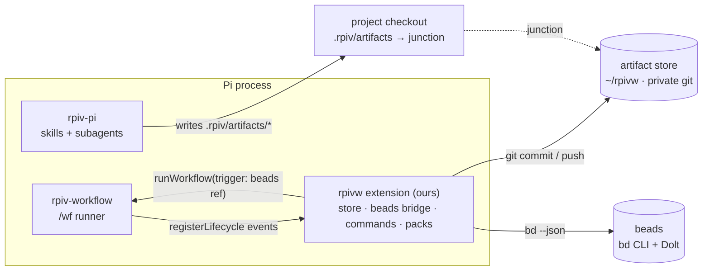

# Thin layer design

Phase 1 design, following the driver's decisions of 2026-10-01 (see `PROGRESS.md`):
stay on **Pi**, **solo** reader, **private git** backup, **long-lived projects**, and
**beads + Dolt** for the work graph. Inputs: [03 needs](03-rpiv-needs.md) and
[04 scenarios](04-scenarios.md).

Versions this design is checked against: Pi `0.87.1`, rpiv-pi and rpiv-workflow
`2.11.0` (installed, matching the submodule), beads `ce512c3` (not yet installed
locally). Statements marked **verify** are assumptions the first build slice must test.

## What the decisions change

| Decision | Consequence |
| --- | --- |
| Stay on Pi | Stack **S2 (rpiv + beads)** is the direction. S3 (OpenSpec + Backlog.md) is dropped, but OpenSpec's living-spec format is still borrowed. The core no longer needs to be host-agnostic: we build a **Pi extension**. |
| Solo reader | No SaaS mirror (Linear/GitHub). Gates and approvals can be lightweight. |
| Private git is fine | The artifact store is a git repo with a private remote, which gives backup and history at once. |
| Long-lived projects | **Living specs move from "defer" to in scope** (milestone M6). A project brief per project is worth keeping. |
| Install Dolt + beads | beads is the work graph. Phase 2 mocks compare *how* to map RPIV onto beads, not whether to use it. |

## Architecture



**Principle: adopt rpiv and beads unchanged, and add one extension that joins them.**
rpiv-workflow gives us two hooks that make this possible without a fork:

- `registerLifecycle({...})` (`rpiv-workflow/docs/embedding.md`, "Cross-package
  lifecycle") delivers every run's `onStageEnd`, `onWorkflowEnd`, and other events to
  our extension *after* the JSONL row lands, including the stage's output artifacts.
- The programmatic runner accepts `trigger: { kind: "external", source, ref }`, so a
  run can be started *from a bead* and the bead ID lands in the run's JSONL header.

Pi provides the rest (`docs/extensions.md`): `registerCommand` for `/work …`,
`registerTool` for model-callable actions (record a deviation, split), and
`before_agent_start` to inject the current work item's context.

## M1: Artifact store

### Layout

**Decided 2026-10-03: one private repo for all projects.** That means one remote,
one push, and one place to search. A project can be split out later with
`git subtree split` if it ever needs its own history or permissions.

```text
~/rpivw/                                 git repo → private remote
  registry.json                          repo-key → { name, paths[] }
  .beads/                                ONE beads DB for all projects (prefix rw), ignored by git; syncs via refs/dolt/data
  .gitignore                             .beads/, .beads.gate.lock
  config.json                            global settings (gates, deviation handling); see M3
  projects/<repo-key>/
    project.md                           one-page brief: purpose, stack, conventions
    artifacts/                           mounted at <checkout>/.rpiv/artifacts
      goal/ research/ designs/ plans/ …  rpiv's buckets, unchanged
      outcomes/                          ours: planned vs. actual per work item
      runs/                              copies of finished run JSONL
    config.json                          optional per-project overrides of the global config
    specs/<capability>.md                living specs (M6)
```

- **repo-key**: the normalized `origin` URL (`github.com/<user>/dashboard`), falling
  back to the repo's root commit hash. `registry.json` maps it to a short name.
- **Mounting.** rpiv hardcodes `.rpiv/artifacts/` throughout its skills and its runtime
  (`rpiv-workflow/worktree-digest.ts`, `death-scene.ts`, and more), so we don't relocate
  it. Instead, `<checkout>/.rpiv/artifacts` becomes a **directory junction** (Windows,
  no admin rights needed) or a symlink (Unix) to the store. Every git worktree of the
  project gets its own junction to the *same* store, which fixes worktree fragmentation.
  The extension creates the junction on `session_start` when the repo is registered
  and the junction is missing.
- **Don't put `~/rpivw` inside a Google Drive sync folder.** Sync clients can corrupt
  `.git`. The private remote is the backup, and reports go to the Drive folder separately (M5).
- `.rpiv/workflows/runs/` (run JSONL and child sessions) stays project-local and
  ephemeral. The extension copies each finished run's JSONL into
  `artifacts/runs/` so the audit trail is backed up too.

### History and backup

- **Auto-commit on `onStageEnd`**: `git -C ~/rpivw add projects/<key>` and commit with a
  structured message: `"<run-id> <stage> [<bead-id>]: <artifact paths>"`.
- **Push on `onWorkflowEnd`**, plus `/work sync` to run it by hand. A failed push warns and never blocks a run.
- **beads data** syncs with `bd dolt push`/`pull` to `refs/dolt/data` on the **same** private
  remote (`git+ssh://git@github.com/<user>/rpivw-store.git`). Verified against a local
  bare repo in M0 (research 06). Set `sync.remote` explicitly.

> [!TIP] Verified 2026-10-03 (Windows 11, Git 2.56, rpiv-workflow 2.12.0)
> 1. rpiv's `computeWorktreeDigest` / `hashArtifactsTree` sees writes through the junction. The walk starts *at* the junction; it only skips symlinks nested inside.
> 2. `git clean -fd`, `-xfd`, and `-xffd` remove only the junction. The store's files survive. With `.rpiv/` in `.git/info/exclude` (done by `/work init`), plain `-fd` doesn't touch it.
> 3. Still open: a live `/wf` run end to end (the M1 exit check).

## M2: Beads bridge

### Mapping

| rpiv-workflow concept | beads concept |
| --- | --- |
| Project | A `project:<key>` label on every bead in **one shared database** (`BEADS_DIR=~/rpivw/.beads`, stealth, prefix `rw`). Dolt allows one database per remote ref (research 06). |
| Feature, bug, or chore | A bead of that type. Big items are epics with child beads. |
| A `/wf` run over that item | Recorded in the bead's metadata. The bead ID is the run's trigger `ref`. |
| A phase checkpoint that needs you | A **human gate** bead blocking the next step |
| A split | Child beads (`--parent`) plus `dep add` edges |

**Open mapping question for the mocks:** does each work item get *one* bead with
its RPIV phase in metadata (lean), or a **molecule** poured from an `rpiv-build`
formula, with one bead per phase plus gates (visible on boards, but 5–7 beads per item)?
The strawman is lean by default, with molecules only for `build`-sized work. Scenario
mocks 2 and 4 decide.

### Links in both directions

Bead metadata, the beads-sanctioned extension point (`beads/docs/core-concepts/metadata.md`):

```json
{
  "rpiv": {
    "phase": "plan",
    "workflow": "build",
    "runs": ["2026-10-01_14-03-22-9f2a"],
    "artifacts": { "goal": "goal/…md", "research": "research/…md", "plan": "plans/…md" },
    "origin": { "artifact": "research/…md", "section": "Recommendations" }
  },
  "execution_suggested_model": "mid",
  "execution_reasoning_effort": "medium"
}
```

Artifact front matter gets stamped after each stage (see M3) with `work: <bead-id>`.
The `execution_*` keys are beads' own convention for model routing, and they map onto
rpiv's per-stage model config (requirement 6).

### Commands and tools

| Surface | What it does |
| --- | --- |
| `/work new "<brief>" [--type …] [--parent <bead>]` | Create the bead with the brief verbatim as its description. rpiv's own `goal` stage writes the goal artifact when the run starts. |
| `/work next [--all]` | In-progress and ready beads for this project (or all), epics listed separately: the "cold resume" command (scenario 6) |
| `/work start <bead> [workflow]` | Claim the bead and send `/wf <workflow> <brief> --name <bead>--r<n>` (default `ship`). **Built 2026-10-03.** The link uses the run name, not `trigger.ref`: the programmatic runner would block the command and lose `/wf`'s detached lane, while the name lands in the JSONL header and survives resumes. |
| `/work status [<bead>]` | Phase, runs, artifacts, open gates |
| `/work approve <gate>` | `bd gate resolve`, so a run parked on that gate can resume |
| Tool `work_deviation` | Called by the model during implement: records a plan deviation (M3) |
| Tool `work_split` | Called during split (M4). Creates child beads after you confirm via ask-user-question. |

All bead access goes through `bd … --json`, never the Dolt files. Read stdout only, because
warnings on stderr break JSON. Every created bead and gate gets the `project:<key>` label
explicitly, since children and gates don't inherit labels (research 06). That's the rule the beads
community tools follow, and it survives schema migrations.

### Lifecycle → beads

| rpiv event | Effect |
| --- | --- |
| `onWorkflowStart` (trigger ref is a bead) | Bead → `in_progress`. Append the run ID to metadata. |
| `onStageEnd` | Update `metadata.rpiv.phase` and `artifacts`. Stamp the artifact front matter. Commit the store. |
| `onStageError` | Add a bead comment with the failure and its run ID. The bead stays in progress. |
| `onWorkflowEnd` success | Write the outcome artifact. Close the bead, or leave it open if follow-ups were spawned. Push the store. |

## M3: Envelope, revision, and deviation

**Envelope by stamping, not by templates.** rpiv's skills already write `date`,
`author`, `commit`, `branch`, `topic`, `tags`, `status`, `parent`, and `last_updated`.
After each stage, the extension adds `id` (ULID, written once), `work` (bead ID),
`run`, and `workflow` (`rpivw@<version>`) to the artifact's front matter. rpiv's skill
files are untouched. **Verify**: rpiv's contract schemas accept unknown front-matter
keys, so no `additionalProperties: false` on the consumed fields.

**Revision without touching artifact bodies.** rpiv's `revise` and `amend` rewrite
plans in place, so a revision-log section inside the artifact could be lost. Instead:

1. The store's git history holds the exact diff (from the auto-commit).
2. The **why** goes in two places the extension controls: the commit message and a bead comment
   (`bd comments add`), each tagged with its trigger: `review`, `deviation`, `scope`, or `driver`.
3. `/work status <bead>` shows that timeline, and the weekly report summarizes it.

**Deviation as a tool.** A guidance snippet, injected during `implement` stages via
`before_agent_start`, tells the model to call `work_deviation` whenever the plan is
wrong. The tool takes:

```text
severity: minor | major      phase: <n>      found: <what reality turned out to be>
impact: <which plan phases change>           proposal: <continue | revise>
```

- **minor**: logged as a bead comment, and implement continues. It also **notifies** you:
  a Pi notification, plus a "minor deviations" list in the next report. This is controlled
  by `deviations.minor` (`notify` | `log`). The default is `notify` while the
  workflow is being tuned (decided 2026-10-03). Switch to `log` once you trust the flow.
- **major**: logged, plus a **human gate** on the bead. The tool returns "stop and
  report", and the run halts cleanly. After `/work approve`, the next step is
  `/skill:revise <plan>` and a resumed run. That's scenario 2's loop, with a full trail.

### Checkpoints and gates

There are two kinds of checkpoint, with different jobs:

- **Live checkpoints** happen in-session while you're at the keyboard. rpiv already has
  them: the `discover` interview, `design-review` in `build`, `blueprint`
  micro-checkpoints, and `ask_user_question`. They need nothing new.
- **Async gates** are for decisions you make later, for example after reading on your phone.
  A gate is a beads `human` gate that blocks the next step. The run stops cleanly and
  resumes once the gate is resolved.

**Mechanism.** Our workflow pack inserts an `await-gate` **script stage** (no model, no
session; see "Script stages" in `rpiv-workflow/docs/workflow-authoring.md`) at each
gate point:

1. On first entry, it creates the gate (`bd gate create`, type `human`, blocking the bead)
   with a 3-line summary and a link to the rendered artifact. Then it halts, so rpiv
   reports `stopped at <gate>`.
2. `/work approve <gate> [notes]` resolves the gate (`bd gate resolve`), adds any
   notes as a bead comment, and resumes `/wf @<run-id>`.
3. rpiv's resume re-runs the halted stage. The gate is now closed, so the stage passes
   and the run continues. Approval notes go into the next stage's prompt.
4. `/work reject <gate> <notes>` sends the run to `revise` (or `amend`) with the
   notes, then a fresh gate.

**Verify:** the cleanest way for a script stage to halt in a way that is resumable
(throwing gives `FAIL_SCRIPT_THREW`, and the resume re-runs that stage). Also check
that the halt reads well in the lane recap.

**Defaults (decided 2026-10-03, configurable in `config.json` → `gates`):**

| Checkpoint | When | Default |
| --- | --- | --- |
| Goal / acceptance | After `acceptance` | Off (live via `discover`) |
| Design approval | After design | Live (`design-review`) |
| **Plan approval** | After plan/grade, before implement | **Async gate on `build`**, off on `ship` |
| **Major deviation** | `work_deviation` with `major` | **Async gate, always** |
| Minor deviation | `work_deviation` with `minor` | Notify, no gate (`deviations.minor`) |
| Validation exhausted | `validate` still failing after one remediate | rpiv halts already. We add a bead record and a report entry. |
| Split confirmation | `/split` | Live (`ask_user_question`) |
| Before commit | After validate | Off (`code-review` covers it). Can be enabled per project. |

So `ship` work runs without stopping unless reality diverges, and `build` work asks
for about one async decision (the plan). Reports list open gates under "Awaiting you".

```json
// ~/rpivw/config.json (sketch)
{
  "gates": { "planApproval": ["build"], "beforeCommit": [] },
  "deviations": { "minor": "notify", "major": "gate" }
}
```

## M4: Split

`/split <artifact | bead>` (a skill plus the `work_split` tool):

1. Read the artifact, propose N children (title, type, size tier, dependencies, and the
   **start phase**) and confirm with ask-user-question.
2. Create the children with `--parent <bead>`, add `dep add` edges, and set
   `metadata.rpiv.origin` to the parent artifact and section.
3. A child that starts past research runs a **project pack** workflow starting at
   design, with the parent's research artifact as input. rpiv's `design` already
   consumes a research artifact path, so this needs a new pack but no skill changes:

```typescript
// ~/.config/rpiv-workflow/packs/rpivw-from-research.ts (sketch)
// stages: design → plan → implement → validate → commit
// input:  the parent research artifact path (via /work start <child>)
```

## M5: Reports

`/work report [--week]` collects the following and renders through this repo's
`html-report` script into `RPIV_REPORT_DIR` (a Drive folder):

- Beads summary: ready, in progress, blocked, and pending **gates**.
- Outcomes closed this period.
- Revision and deviation timelines.

Pending gates are the actionable part: read the plan on your phone, then
`/work approve` at the keyboard. A later option is an artifact page that records
approvals for the extension to pick up.

## M6: Living specs

Specs use OpenSpec's format (`### Requirement:` with SHALL plus `#### Scenario:`), one
file per capability under `projects/<key>/specs/`:

- Design artifacts gain a **behavior delta** (ADDED/MODIFIED/REMOVED requirements).
  This needs a small `design` addendum skill or a post-design stage. Exact mechanism TBD.
- A close-out stage `spec-merge` (our skill) applies the delta after a successful validate.
- The extension injects a capability index (names plus one-line purposes) into research
  stages, so research checks *intended* behavior as well as code.

## Build order

| Milestone | Scope | Exit check |
| --- | --- | --- |
| **M0** ✓ | Install `bd` and `dolt` on Windows. Smoke-test stealth mode with `BEADS_DIR` and `bd dolt push` to a private remote. | Done 2026-10-03 (research 06) |
| **M1** (built) | Extension skeleton, store, registry, junction mount, auto-commit and push | An rpiv `research` run lands in `~/rpivw` with a commit, from a worktree too |
| **M2** (built) | `/work new/next/start/status`, lifecycle → beads | A `/wf ship` run started from a bead closes that bead |
| **M3** (built) | Stamping, revision timeline, `work_deviation` + gates | Scenario 2 replay: a major deviation parks the run and shows in `/work status` |
| **M4** | `/split` + the `rpivw-from-research` pack | Scenario 3 replay: three children, with one starting at design |
| **M5** | `/work report` → html-report → Drive | A weekly page on the phone |
| **M6** | Living specs | A feature's behavior delta merges into `specs/` |

M0–M2 make the minimum usable system. M3–M4 cover the two gaps no existing tool fills.

## Risks specific to this design

1. **Coupling to rpiv internals.** We rely on the `.rpiv/artifacts/` path, front-matter
   shape, and lifecycle API of rpiv `2.11`–`2.12`. Pi updated rpiv from 2.11.0 to 2.12.0 between 2026-10-01 and 2026-10-03 without notice, and the extension's version check caught it. Mitigation: the extension checks the installed
   rpiv-workflow version at startup and warns on a major or minor change. A contract test
   suite runs our hooks against a pinned rpiv.
2. **Single active Pi session.** `runWorkflow` from `/work start` must wait for idle
   (Pi's command context has a wait-until-idle operation; exact name unverified). There's no process-wide mutex
   (`embedding.md`, "Trigger metadata").
3. **beads churn and Windows.** The beads README documents a schema-version guard and
   migrations. Pin the `bd` version in `project.md`, and run `bd` only through our wrapper.
4. **Junction edge cases** (tools that refuse to follow reparse points, backup software).
   M1's exit check covers rpiv. Others get discovered as we go.
5. **Gate fatigue.** If every phase has a human gate, approvals become rubber stamps.
   Default gates go only on plan approval (`build`) and major deviations. Minor
   deviations notify for now. Mocks and real use will tune this through `config.json`.

## Questions for Phase 2 mocks

1. Lean bead vs. molecule per work item: which reads better on `/work next` and on a board?
2. Does the async plan-approval gate on `build` feel right, or would a live checkpoint be better? Are minor-deviation notifications useful or noisy?
3. Is the commit message plus bead comment enough for "why did the plan change", or is a rendered timeline needed?
4. Does starting a split child at design, reusing the parent's research, work smoothly in rpiv?
5. How much of `/work start` should pick the workflow (`ship` vs. `build`) automatically?

## Revision log

- 2026-10-01: First draft, after the driver's Phase 0 answers.
- 2026-10-04: M3 built. Tracked `<name>-rpivw` workflows: plan-approval (configured) + deviation-check (always) script stages spliced into rpiv-pi’s live built-ins. Front matter is stamped under one `rpivw:` block. The design was adjusted from the original "revision log in commit messages + bead comments": both exist, plus `--reimplement` routing.
- 2026-10-03: M2 built. Runs link to beads by run name (`<bead>--r<n>`), not `trigger.ref`. `/work start` sends `/wf` through `pi.sendUserMessage` so the run keeps its detached lane.
- 2026-10-03: M1 built. Junction + rpiv digest and `git clean` behavior verified. The bridge joins rpiv's lifecycle registry directly (no import).
- 2026-10-03: M0 findings: one shared beads DB with project labels, explicit labeling, stdout-only parsing, and a same-remote Dolt sync (verified locally).
- 2026-10-03: Driver decisions: one store repo for all projects, an async plan-approval gate on `build`, and minor deviations notify (configurable). Added the "Checkpoints and gates" section and `config.json`.
